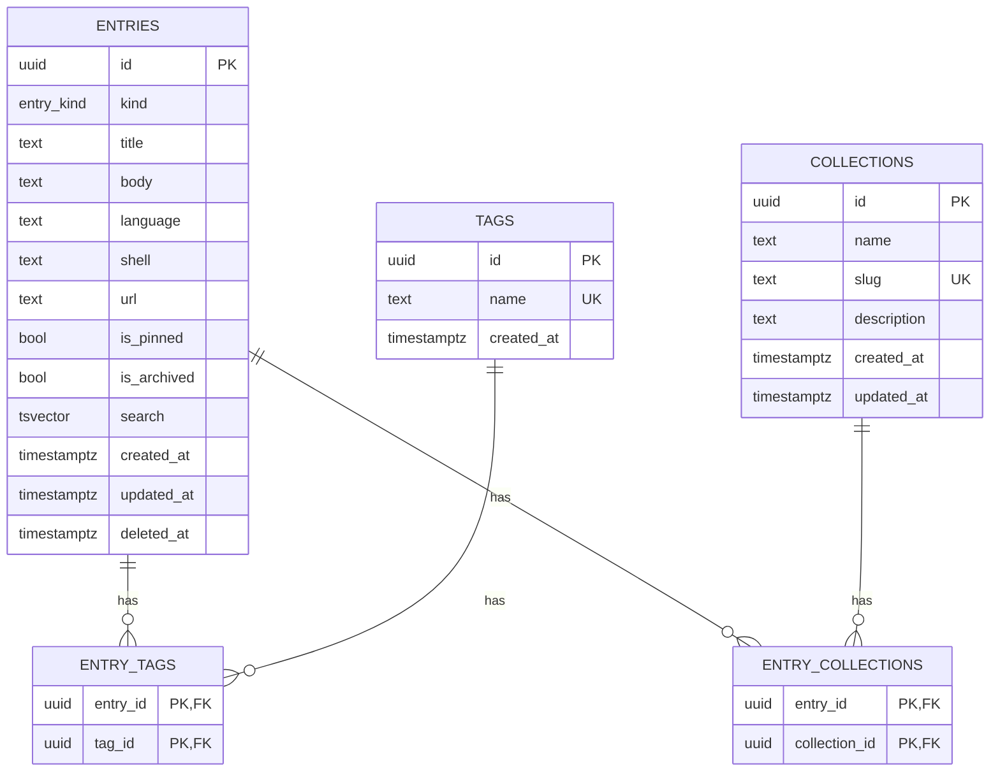

# DevVault — Database Schema

- **Status:** Draft v1.0
- **Last updated:** 2026-11-04
- **Database:** PostgreSQL 16+
- **Related:** [Architecture §7](../01-architecture.md#7-search-architecture) · [API Spec](./04-api-specification.md) · [ADR-0003](../adr/0003-unified-entries-model.md) · [ADR-0006](../adr/0006-uuidv7-primary-keys.md)

This document is the authoritative schema reference. The SQL here matches the files in `backend/migrations/`.

---

## 1. Entity–relationship overview



## 2. Conventions

- **Identifiers:** UUIDv7, generated by the application (`uuid::Uuid::now_v7()`) and passed on insert. See [ADR-0006](../adr/0006-uuidv7-primary-keys.md).
- **Timestamps:** `timestamptz`, stored in UTC, serialised RFC3339. `updated_at` maintained by trigger.
- **Soft delete:** `deleted_at timestamptz NULL`; non-null means the row is in Trash.
- **Text:** use `text` (never `varchar(n)`); enforce length in validation, not the schema, unless a hard cap is meaningful.
- **Naming:** snake_case, singular table names are avoided in favour of plural (`entries`, `tags`) per Postgres convention.
- **Extensions:** `pg_trgm` (fuzzy search), `unaccent` (diacritic-insensitive search). A `uuidv7()` app-level helper is used on PG16.

## 3. Extensions & helper functions

```sql
-- Migration: 0001_init_extensions.sql
CREATE EXTENSION IF NOT EXISTS pg_trgm;
CREATE EXTENSION IF NOT EXISTS unaccent;

-- Immutable wrapper so unaccent() can be used in a generated column / index.
CREATE OR REPLACE FUNCTION immutable_unaccent(text)
RETURNS text
LANGUAGE sql IMMUTABLE PARALLEL SAFE STRICT AS $$
  SELECT public.unaccent('public.unaccent', $1)
$$;

-- Maintain updated_at on every UPDATE.
CREATE OR REPLACE FUNCTION set_updated_at()
RETURNS trigger
LANGUAGE plpgsql AS $$
BEGIN
  NEW.updated_at = now();
  RETURN NEW;
END;
$$;
```

## 4. Enums

```sql
-- Migration: 0002_init_enums.sql
CREATE TYPE entry_kind AS ENUM ('snippet', 'command', 'note', 'link', 'doc');
```

Adding a kind later is additive (`ALTER TYPE entry_kind ADD VALUE 'x'`) and requires no data migration.

## 5. Core tables

### `entries`

```sql
-- Migration: 0003_create_entries.sql
CREATE TABLE entries (
    id              uuid        PRIMARY KEY,

    kind            entry_kind  NOT NULL,
    title           text        NOT NULL CHECK (length(btrim(title)) BETWEEN 1 AND 300),
    body            text        NOT NULL DEFAULT '',

    -- kind-specific (nullable by design; enforced in the validation layer)
    language        text        CHECK (language IS NULL OR length(language) <= 50),
    shell           text        CHECK (shell IS NULL OR length(shell) <= 50),
    url             text        CHECK (url IS NULL OR length(url) <= 2048),

    is_pinned       boolean     NOT NULL DEFAULT false,
    is_archived     boolean     NOT NULL DEFAULT false,

    -- search document: title weighted highest, then language/kind, then body
    search          tsvector    GENERATED ALWAYS AS (
        setweight(to_tsvector('english', immutable_unaccent(coalesce(title, ''))), 'A') ||
        setweight(to_tsvector('english', immutable_unaccent(coalesce(language, ''))), 'B') ||
        setweight(to_tsvector('english', immutable_unaccent(coalesce(shell, ''))),    'B') ||
        setweight(to_tsvector('english', immutable_unaccent(coalesce(body, ''))),     'C')
    ) STORED,

    created_at      timestamptz NOT NULL DEFAULT now(),
    updated_at      timestamptz NOT NULL DEFAULT now(),
    deleted_at      timestamptz,

    -- kind-specific requirements enforced at the DB as a safety net
    CONSTRAINT link_requires_url   CHECK (kind <> 'link'    OR url      IS NOT NULL),
    CONSTRAINT snippet_requires_lang_or_null CHECK (kind <> 'snippet' OR true) -- language optional
);

CREATE TRIGGER trg_entries_updated_at
    BEFORE UPDATE ON entries
    FOR EACH ROW EXECUTE FUNCTION set_updated_at();
```

> Note: tag text is folded into the search vector at query time via `entry_tags` (see §7), because tags live in a join table and cannot be referenced from a generated column. The search query unions a tag-match predicate rather than embedding tag text in the generated column.

### `tags`

```sql
-- Migration: 0004_create_tags.sql
CREATE TABLE tags (
    id          uuid        PRIMARY KEY,
    name        text        NOT NULL CHECK (length(btrim(name)) BETWEEN 1 AND 50),
    created_at  timestamptz NOT NULL DEFAULT now()
);

-- case-insensitive uniqueness so "Rust" and "rust" are the same tag
CREATE UNIQUE INDEX idx_tags_name_lower ON tags (lower(name));
```

### `entry_tags` (join)

```sql
-- Migration: 0004_create_tags.sql (cont.)
CREATE TABLE entry_tags (
    entry_id    uuid        NOT NULL REFERENCES entries(id) ON DELETE CASCADE,
    tag_id      uuid        NOT NULL REFERENCES tags(id)    ON DELETE CASCADE,
    PRIMARY KEY (entry_id, tag_id)
);

CREATE INDEX idx_entry_tags_tag   ON entry_tags (tag_id);
CREATE INDEX idx_entry_tags_entry ON entry_tags (entry_id);
```

### `collections`

```sql
-- Migration: 0005_create_collections.sql
CREATE TABLE collections (
    id          uuid        PRIMARY KEY,
    name        text        NOT NULL CHECK (length(btrim(name)) BETWEEN 1 AND 100),
    slug        text        NOT NULL CHECK (slug ~ '^[a-z0-9]+(?:-[a-z0-9]+)*$'),
    description text        NOT NULL DEFAULT '',
    created_at  timestamptz NOT NULL DEFAULT now(),
    updated_at  timestamptz NOT NULL DEFAULT now()
);

CREATE UNIQUE INDEX idx_collections_slug ON collections (slug);

CREATE TRIGGER trg_collections_updated_at
    BEFORE UPDATE ON collections
    FOR EACH ROW EXECUTE FUNCTION set_updated_at();
```

### `entry_collections` (join)

```sql
-- Migration: 0005_create_collections.sql (cont.)
CREATE TABLE entry_collections (
    entry_id        uuid NOT NULL REFERENCES entries(id)       ON DELETE CASCADE,
    collection_id   uuid NOT NULL REFERENCES collections(id)    ON DELETE CASCADE,
    PRIMARY KEY (entry_id, collection_id)
);

CREATE INDEX idx_entry_collections_collection ON entry_collections (collection_id);
```

## 6. Indexes

```sql
-- Migration: 0006_create_indexes.sql

-- Full-text search
CREATE INDEX idx_entries_search ON entries USING gin (search);

-- Fuzzy / partial matching (title more important than body)
CREATE INDEX idx_entries_title_trgm ON entries USING gin (title gin_trgm_ops);
CREATE INDEX idx_entries_body_trgm  ON entries USING gin (body  gin_trgm_ops);

-- Listing & cursor pagination: only live rows, ordered by created_at
CREATE INDEX idx_entries_live_created
    ON entries (created_at DESC, id DESC)
    WHERE deleted_at IS NULL;

-- Alternative sort for "recently updated"
CREATE INDEX idx_entries_live_updated
    ON entries (updated_at DESC, id DESC)
    WHERE deleted_at IS NULL;

-- Filtering by kind among live rows
CREATE INDEX idx_entries_live_kind
    ON entries (kind)
    WHERE deleted_at IS NULL;

-- Pinned-first ordering among live rows
CREATE INDEX idx_entries_live_pinned
    ON entries (is_pinned DESC, created_at DESC, id DESC)
    WHERE deleted_at IS NULL;

-- Language filtering (snippets)
CREATE INDEX idx_entries_live_language
    ON entries (language)
    WHERE deleted_at IS NULL AND language IS NOT NULL;

-- Trash view: deleted rows only
CREATE INDEX idx_entries_trash
    ON entries (deleted_at DESC, id DESC)
    WHERE deleted_at IS NOT NULL;
```

**Why partial indexes:** every list/search query filters `deleted_at IS NULL`, so the partial `WHERE deleted_at IS NULL` indexes are smaller and faster than full indexes, and the Trash view gets its own dedicated index.

## 7. Search query shape

Because tags are in a join table, tag text is matched through a semi-join and tag matches are *ranked* separately:

```sql
-- Hybrid search: FTS on the generated column, OR a tag name match
WITH q AS (SELECT websearch_to_tsquery('english', immutable_unaccent($1)) AS tsq)
SELECT e.*,
       ts_rank_cd(e.search, q.tsq) AS rank,
       EXISTS (SELECT 1 FROM entry_tags et JOIN tags t ON t.id = et.tag_id
               WHERE et.entry_id = e.id AND t.name ILIKE '%' || $1 || '%') AS tag_match
FROM entries e, q
WHERE e.deleted_at IS NULL
  AND ($2::entry_kind IS NULL OR e.kind = $2)
  AND (e.search @@ q.tsq OR EXISTS (
        SELECT 1 FROM entry_tags et JOIN tags t ON t.id = et.tag_id
        WHERE et.entry_id = e.id AND t.name ILIKE '%' || $1 || '%'))
ORDER BY tag_match DESC, rank DESC, e.created_at DESC, e.id DESC
LIMIT $3;

-- Fuzzy fallback when FTS under-fills:
SELECT e.*, greatest(similarity(e.title, $1), similarity(e.body, $1)) AS sim
FROM entries e
WHERE e.deleted_at IS NULL
  AND (e.title % $1 OR e.body % $1)
ORDER BY sim DESC, e.created_at DESC, e.id DESC
LIMIT $3;
```

`similarity()` and `%` use the `pg_trgm` GIN indexes above. Combination/blending happens in the service layer based on `SEARCH_MIN_TRGM_SCORE` and FTS row count.

## 8. Cursor pagination predicate

```sql
-- descending order on (created_at, id)
WHERE ($cursor_created_at IS NULL
       OR (created_at, id) < ($cursor_created_at, $cursor_id))
ORDER BY created_at DESC, id DESC
LIMIT $limit + 1;   -- fetch one extra to know if a next page exists
```

The `+1` row is not returned; its presence determines `next_cursor`. See [API spec §5](./04-api-specification.md#5-pagination).

## 9. Soft delete lifecycle

| Operation | SQL |
| --------- | --- |
| Delete (Trash) | `UPDATE entries SET deleted_at = now() WHERE id = $1 AND deleted_at IS NULL` |
| Restore | `UPDATE entries SET deleted_at = NULL WHERE id = $1 AND deleted_at IS NOT NULL` |
| Purge | `DELETE FROM entries WHERE id = $1 AND deleted_at IS NOT NULL` |

Service rule: purge is only allowed on rows already in Trash. Cascade deletes clean up `entry_tags` / `entry_collections`.

## 10. Tag & collection maintenance

- **Upsert tag on write:** `INSERT INTO tags (id, name) VALUES ($1, $2) ON CONFLICT (lower(name)) DO UPDATE SET name = tags.name RETURNING id` — conflict target uses the functional unique index; alternatively `ON CONFLICT DO NOTHING` then `SELECT id`.
- **Rename tag:** `UPDATE tags SET name = $2 WHERE id = $1` — the functional unique index prevents collisions.
- **Attach/detach:** inserts/deletes on `entry_tags` and `entry_collections`, wrapped in the entry's transaction.
- **Tag counts:** `SELECT t.id, t.name, count(et.entry_id) FROM tags t LEFT JOIN entry_tags et ON et.tag_id = t.id LEFT JOIN entries e ON e.id = et.entry_id AND e.deleted_at IS NULL GROUP BY t.id ORDER BY count DESC`.

## 11. Migration strategy

- One concern per migration file, timestamped by `sqlx migrate add <name>`, stored in `backend/migrations/`.
- **Never edit a shipped migration**; add a new one.
- Migrations must be **forward-only and additive where practical** (add column with default, backfill, then optionally drop old column in a later release).
- Enum changes are additive (`ADD VALUE`); removing a value requires a new type + column rewrite and is avoided.
- CI runs migrations against a fresh Postgres (catching ordering/extension errors) and against a seeded dataset (catching backfill errors).
- `sqlx migrate run` (or the `sqlx::migrate!` macro the API runs on startup) applies pending migrations; `sqlx migrate info` reports applied/pending.

## 12. Seed / demo data

A dev-only seed (`backend/seeds/demo.sql` or a `cargo run --bin seed`) inserts ~50 entries across all kinds with tags and collections, including deliberate typo-tempting identifiers (`useEffect`, `receiveEvent`) to exercise fuzzy search. Never run in production; gated behind `SEED_DEMO=1`.

## 13. Sizing & retention notes

- Target dataset: tens of thousands of rows — well within a single Postgres instance.
- `search` column adds roughly the size of the indexed text; acceptable.
- Trash is retained indefinitely (single-user choice). A future option could auto-purge after N days.
- No partitioning, no sharding, no read replicas — deliberately out of scope at this scale.

## 14. Full migration order

1. `0001_init_extensions.sql` — `pg_trgm`, `unaccent`, `immutable_unaccent()`, `set_updated_at()`.
2. `0002_init_enums.sql` — `entry_kind`.
3. `0003_create_entries.sql` — `entries` + trigger.
4. `0004_create_tags.sql` — `tags`, `entry_tags`.
5. `0005_create_collections.sql` — `collections`, `entry_collections`.
6. `0006_create_indexes.sql` — all indexes from §6.
